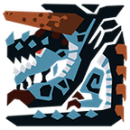
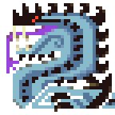
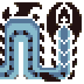
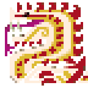
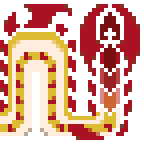
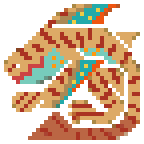
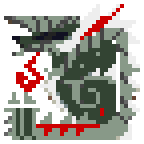
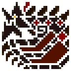
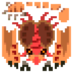

<h1 align="center" style="text-align: center">MH4U Port</h1>

<b>Monster Hunter 4 Ultimate monsters in Monster Hunter Generations Ultimate (Switch, v1.4)</b>

    

        

<a href="#monsters-and-quests">Monsters</a> · <a href="#install">Install</a> · <a href="#how-it-works">How it works</a> · <a href="#contributing">Contributing</a> · <a href="#roadmap">Roadmap</a>

This is not a reskin. The mod injects its own code into MHGU, so each ported monster runs its MH4U behaviour, traced
in MH4U's own code. Each one also comes with its arena, music, sounds, quests, armor, weapons, skills and Hunter's
Notes entry. Everything is **added**: no MHGU monster, quest or item is replaced, so your save and the base game stay
as they are.

> [!NOTE]
> This project will eventually be merged into a larger one (not anytime soon tho). Until then, ports and releases will continue here.

## Monsters and quests

| Monster                            | Quests                      | Arena          |
| ---------------------------------- | --------------------------- | -------------- |
| **Gogmazios**                      | 2 · G★4                     | Battlequarters |
| **Dalamadur** / **Shah Dalamadur** | 6 · HR★7, G★4              | Speartip Crag  |
| **Tigerstripe Zamtrios**           | 1 · G★3                     | –              |
| **Stygian Zinogre**                | 11 · HR★7, G★4, Village★10 | Heaven's Mount |
| **Black Gravios**                  | 8 · HR★7, G★4, Village★10  | –              |
| **Monoblos**                       | 6 · HR★7, G★4, Village★10  | –              |

Quests are on the Hub quest board (Village quests on the village board). Ranks follow MH4U: each quest sits where its
monster's MH4U rank falls among MHGU's quests of the same species.

<b>All quest names</b>

- **Gogmazios:** G★4 *Advanced: Quagmire Quarrel* · *Advanced: Act of Gog*
- **Tigerstripe Zamtrios:** G★3 *Grand Finals Confrontation*
- **Dalamadur:** HR★7 *Advanced: Speartip Menace* · *Advanced: Here to Eternity* · *Pillar of Strength* · G★4
  *The Speartip's King*
- **Shah Dalamadur:** G★4 *Advanced: Eternal Emperor* · *The Crimson Shah*
- **Stygian Zinogre:** HR★7 *Infernal Overlord* · *Advanced: Mega Hunt-a-thon* · *Advanced: Dragon Attack* ·
  *Advanced: Arena Emergency* · *Advanced: Insecticide* · G★4 *Fire Drill* · *Mountain Rescue* · *Into the Heavens* ·
  *A Song of Extremes* (event) · Village★10 *Forge Ahead* · *Advanced: Prickly Pair*
- **Black Gravios:** HR★7 *Advanced: Armor Amore* · *Ore D'oeuvre* · *Advanced: Dance with Dragons* ·
  *Advanced: Gravios Fortunes* · G★4 *Hollow Promise* · *Advanced: A Black Day* · Village★10 *Black Rock Down* ·
  *Advanced: Whale of a Hammer*
- **Monoblos:** HR★7 *Skiff Competition* · *The Hero and the Sandy Spear* · G★4 *Bad Hair Day: Monoblos* ·
  Village★10 *Skiff Competition* · *The Hero and the Sandy Spear* · *Bad Hair Day: Monoblos*

## Install

1. Download every zip you want from **one** release on the [Releases](../../releases) page.
2. Open the game's mod folder:
   - Ryujinx: right-click MHGU > *Open Mods Directory*
   - Yuzu / Eden: right-click MHGU > *Open Mod Data Location*
3. Extract `core` (always needed), then the monsters you want. They all merge into one single `MH4U Port` folder.

> [!WARNING]
> - **Never mix zips from different releases.** A release is one matched set. To update, delete `MH4U Port` and
>   extract the new set.
> - **Unequip a monster's armor and weapons before removing that monster**, otherwise the game will crash.
> - **Online:** everyone in the lobby needs the same release and the same monsters.

## How it works

A release is one mod folder made of three parts:

- **exefs:** a C module (`subsdk1`) loaded next to MHGU, plus an IPS patch that branches MHGU's code into its hooks.
  This is where the ported monster classes and the shared engine (monster registry, quests, gear, items, music, icons,
  stage aliases) live.
- **Data files:** one per monster, holding its tables and text. The code reads them at run time.
- **romfs:** the converted MH4U assets (models, textures, animations, effects, sounds, arenas), loaded through
  layeredFS.

All of it is generated from your own game dumps by about 60 converters in `tools/`. [ARCHITECTURE.md](ARCHITECTURE.md)
has the full map.

## Contributing

| You want to            | You need                                    | Start here                                                                |
| ---------------------- | ------------------------------------------- | ------------------------------------------------------------------------- |
| **Report a bug**       | The game and the mod, nothing else          | Open an [issue](../../issues): your release, what happened, your Ryujinx log |
| **Fix something**      | Your own game dumps and the build setup     | [CONTRIBUTING.md](CONTRIBUTING.md): setup, quick start, workflow          |
| **Port a new monster** | The build setup, then the porting guide     | Open an issue first, then read [notes/porting-guide.md](notes/porting-guide.md) |

> [!IMPORTANT]
> **No game data is in this repo**: no ROM bytes, converted assets or text tables. You build everything from your own
> MH4U (EUR, v1.1) and MHGU (v1.4) dumps.

The build runs on **Linux and Windows**. It needs Python 3.11+, LLVM (clang, lld), ffmpeg, opus and about 30 GB of
disk space; `tools/doctor.py` checks your machine and tells you what is missing. [ARCHITECTURE.md](ARCHITECTURE.md)
maps the repo and the build flow.

**Ports that are still useful.** Some monsters are already done in the project this one will merge into, so working
on them here is wasted effort. Still useful (non-exhaustive list):
- Dah'ren Mohran (MH4U) and Jhen Mohran (MH3U)
- Dire Miralis (MH3U)
- Any monster from the roadmap just below

Open an issue before you start, so nobody else ports the same monster.

> [!IMPORTANT]
> **License of contributions.** Contributions are licensed under GPL-3.0-or-later, like the rest of the project. As
> this project will later be merged into a larger one (see the note at the top), you also agree that your
> contributions may be relicensed under that project's license when the merge happens.

## Roadmap

Subject to change, not ordered

- [x] Gogmazios
- [x] Dalamadur / Shah Dalamadur
- [x] Tigerstripe Zamtrios
- [x] Stygian Zinogre
- [x] Black Gravios
- [x] Monoblos
- [ ] Magnet Spike (MHF-ZZ weapon class), in progress as of Oct 29, 2026
- [ ] Tidal Najarala
- [ ] Shrouded Nerscylla
- [ ] Desert Seltas Queen & Desert Seltas
- [ ] G-rank Crimson Fatalis
- [ ] White Monoblos
- [ ] Pink Rathian
- [ ] Azure Rathalos
- [ ] Blue Yian Kut-Ku
- [ ] Purple Gypceros
- [ ] Red Khezu
- [ ] Ruby Basarios
- [ ] Black Diablos
- [ ] Emerald Congalala
- [ ] Ash Kecha Wacha
- [ ] Berserk Tetsucabra
- [ ] Plum Daimyo Hermitaur
- [ ] Oroshi Kirin
- [ ] Rusted Kushala Daora
- [ ] Dah'ren Mohran

## Credits

- [@jM5557](https://github.com/jM5557), for adding support to Yuzu, Eden and other Yuzu-based emulators
- [@Rukasu1609](https://github.com/Rukasu1609), for the Black Gravios ([PR #12](https://github.com/Scrimas/MH4U-port-to-MHGU/pull/12))
  and Monoblos ([PR #17](https://github.com/Scrimas/MH4U-port-to-MHGU/pull/17)) ports

## License

GNU General Public License v3.0 or later (GPL-3.0-or-later): you can redistribute and modify this project under version 3 of the License or, at your option, any later version. See [LICENSE](LICENSE). Game data and assets stay their owners' and are not covered by this license.
